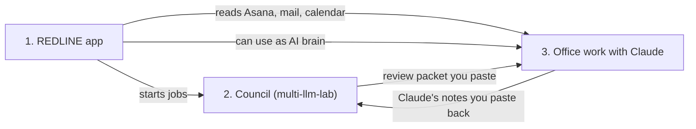
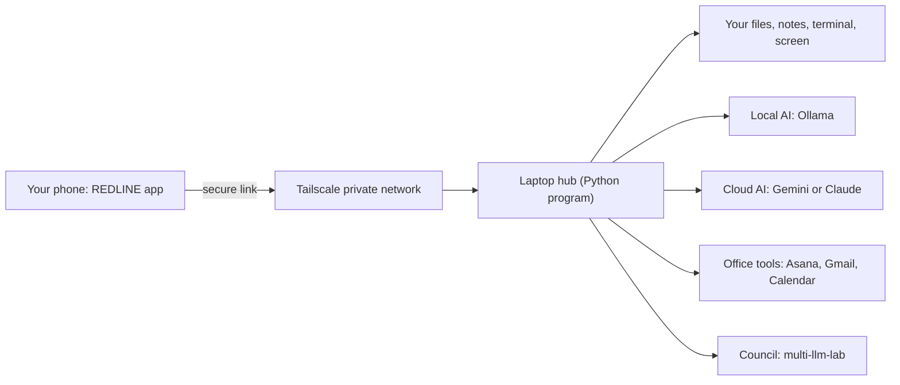
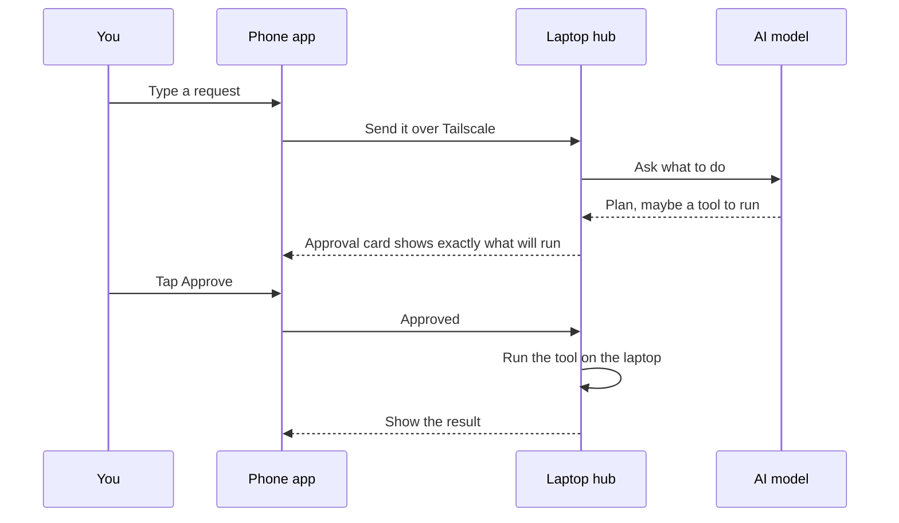

# 00 · The big picture

**What this page is for:** one calm overview of what REDLINE is, how it fits into your work, and what happens when you tap a button.

## What REDLINE is

REDLINE is an app on your Android phone. It lets you use your Windows laptop from anywhere.

You can talk to an assistant, read files, write notes, check Asana, watch your screen, and run commands. The laptop does the real work. The phone is only the remote control.

> ✅ **Check:** REDLINE is the app's name. The project and folder are still called **Laptop Hub** (repo `laptop-hub`). Both names mean the same thing.

## Your three worlds

You work in three places. They are separate, but they help each other.

| World | What it is | Where it lives |
|---|---|---|
| **1. REDLINE app** | Your phone remote for the laptop. | `laptop-hub` project |
| **2. The council** | Several AI models that work on a task together, as a team. | `multi-llm-lab` project |
| **3. Office work with Claude** | Your day job, done with Claude on the laptop. | Your normal tools and Claude |

How they connect:

- REDLINE can **start the council** from the phone (Council screen).
- REDLINE can **use Claude** as one of its AI brains.
- REDLINE's **Work** screen and **Friday** read your office tools: Asana, mail and calendar.

> ⚠️ **Careful:** The council never calls Claude by itself. You copy a "review packet" to Claude by hand, then paste Claude's notes back. See page 07.

## The whole system in one picture

Plain words:

- The **phone app** only shows screens and sends taps.
- **Tailscale** is a private tunnel. Only your own devices can use it.
- The **hub** is a small program on your laptop. It does everything.
- The hub asks an **AI model** when it needs thinking.

## What happens when I tap something

Example: you open **Talk** and type "Find my sharding notes".

Key point: **anything that changes the laptop waits for your tap.** Reading is free. Writing, running commands and sending need an approval card.

## What is proven and what is not

REDLINE was built in a test setup with fake models and a fake operating system. Then it had one real first run.

| Status | What |
|---|---|
| 🟢 **Worked on the first real run** | The app loads over Tailscale. Terminal, Talk, Learn and Files screens show. File open and download. Android builds succeed in the cloud. |
| 🟡 **Not tested on real devices yet** | Gmail, Asana and calendar with real accounts. Payment (UPI) capture. Android notification access. Hands-free voice on the phone. Remote-screen touch control. Starting apps from the Start Menu. Cloudflare WARP button. The Claude + Gemini duo with real quotas. |

> ⚠️ **Careful:** For anything marked 🟡, expect small bugs the first time. Run `python -m hub doctor` first, then see page 09.

## Where to go next

- First time using it: [01 · First day](01-first-day.md)
- Want the pieces explained: [02 · How it works](02-how-it-works.md)
