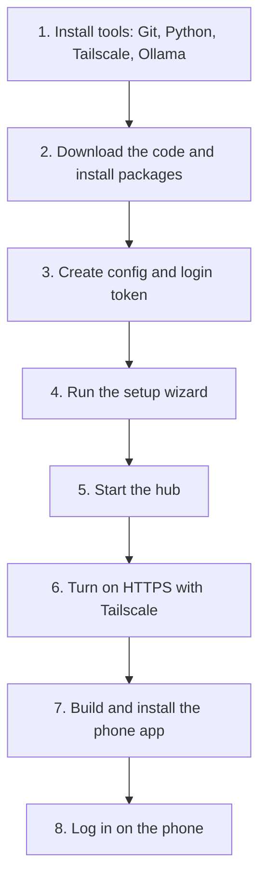

# 01 · Your first day

**What this page is for:** what you need, the order to install it, how to log in for the first time, and what each screen does.

## What you need

| Item | Why |
|---|---|
| A Windows laptop | The hub runs here. It must be on and awake. |
| An Android phone | Where you use the app. |
| A free Tailscale account | The private link between phone and laptop. |
| Python 3.11 or newer | The language the hub is written in. |
| Ollama (optional but recommended) | A free AI that runs on the laptop. |
| A GitHub account | To download the code and build the phone app. |

> ✅ **Check:** Everything below is free. Cloud AI (Gemini, Claude) is optional.

## Install order

Do these in order. Page 08 has the full wizard walk-through.



Short version, in PowerShell, one command per block:

```powershell
winget install --id Git.Git -e
```

```powershell
winget install --id Python.Python.3.12 -e
```

```powershell
winget install --id Tailscale.Tailscale -e
```

```powershell
winget install --id Ollama.Ollama -e
```

Close PowerShell and open a new window. Then get the code:

```powershell
git clone https://github.com/ShikharGupta0813/laptop-hub
```

```powershell
cd laptop-hub
```

```powershell
python -m venv .venv
```

```powershell
.venv\Scripts\activate
```

```powershell
pip install -r requirements.txt -r requirements-voice.txt -r requirements-work.txt -r requirements-laptop.txt
```

Create your settings and your login token:

```powershell
python -m hub init --root study=C:\Users\YOU\Documents\study
```

Replace `YOU` with your Windows user name. Add one `--root name=folder` for each folder you want to see in the app. A `notes` and an `inbox` folder are added for you.

> ⚠️ **Careful:** If you leave out `--root`, the hub shares your **whole user folder** (named `home`). Choose folders on purpose.

> ⚠️ **Careful:** `init` prints your **login token once**. Copy it into a password manager right away. Never paste it into chat, email or a screenshot.

Then run the wizard and the health check:

```powershell
python -m hub setup
```

```powershell
python -m hub doctor
```

Start the hub (leave this window open) and add HTTPS in a second window:

```powershell
python -m hub serve
```

```powershell
tailscale serve --bg 8765
```

```powershell
tailscale serve status
```

`status` prints your address. Yours is `https://shikharonestack.tail3ffc35.ts.net`.

## The phone app

You have two ways to get the app on your phone.

| Way | How | Good for |
|---|---|---|
| **Android app (APK)** | On GitHub: Actions, then **Build Android APK**, Run workflow, paste your address, download `laptop-hub-debug-apk`. | Notification access, payment capture, file downloads |
| **Web app** | Open the address in Chrome, then menu, **Install app**. | Quick start, no build |

> ⚠️ **Careful:** Every APK build is signed with a new key. To install a newer build, **uninstall the old app first**. Your data lives on the laptop, so nothing is lost.

> ⚠️ **Careful:** The APK has been built in the cloud but **has not been tested on many real devices yet**. The phone-only features (payment capture, notification watching) are 🟡 not tested on real devices yet.

## First login

1. Turn on **Tailscale** on the phone. Sign in to the same account as the laptop.
2. Check that `python -m hub serve` is running on the laptop and the laptop is awake.
3. Open **REDLINE**.
4. Paste your login token. Use the eye button to show or hide it.
5. Tap log in. You land on **Home**.
6. Allow the **microphone** when Android asks.

> ✅ **Check:** If it says "That token didn't match", copy the token again. Five wrong tries lock login for one minute.

## A tour of the screens

The bottom bar has five tabs. The top bar has search, the bell and settings.

| Screen | How to reach it | What it is for |
|---|---|---|
| **Home** | Bottom bar | Your dashboard. What needs you now, today's meetings, the Friday card. |
| **Talk** | Bottom bar | Speak or type to the assistant. It can use your laptop. |
| **Work** | Bottom bar | Asana tasks, meetings, write email, post to Google Chat. |
| **Learn** | Bottom bar | Chat with notes, quizzes, flashcards, English coach. |
| **Apps** | Bottom bar | A searchable list of every feature. |
| **Notes** | Apps | Voice or typed notes, saved as Markdown files. |
| **Files** | Apps | Browse and edit files in your shared folders. Trash you can restore. |
| **Terminal** | Apps | A real PowerShell or WSL window on the laptop. |
| **Laptop** | Apps | Laptop status, quick buttons, upload, log out. |
| **Remote screen** | Apps | See the laptop screen. Control is a separate switch. |
| **Launcher** | Apps | Open any app, folder or link on the laptop. |
| **Council** | Apps | Run the multi-model team as a background job. |
| **Friday** | Home card | Spoken daily brief, day plan, laptop prep. |
| **Spending** | Apps | Expenses. Android can add payments for you. |
| **Watch** | Apps | Alerts for urgent Gmail and Google Chat. |
| **Notifications** | Bell icon | Your notification list. |
| **Setup** | Home card | A checklist of every connection, with fixes. |
| **Settings** | Gear icon | Models, folders, themes, backups, activity log. |

Also in Apps: To-do, Habits, Journal, Focus timer, Reminders, Tools, Read later, Routines (Automations).

> ✅ **Check:** Lost? Tap the search icon. One box searches notes, files, tasks and apps.

## Your daily routine

Keep it small. This is enough.

| When | Do this |
|---|---|
| Morning | Open **Home**. Tap **Brief me** on the Friday card. |
| During the day | Use **Talk** for quick jobs. Use **Notes** for voice notes. |
| Before leaving the desk | Check **Setup** is green. Make sure the laptop is plugged in. |
| Once a week | Tap **Update REDLINE** (page 08). Make a backup in Settings. |

> ⚠️ **Careful:** If the laptop sleeps or Tailscale is off, the app cannot reach it. See page 09.
