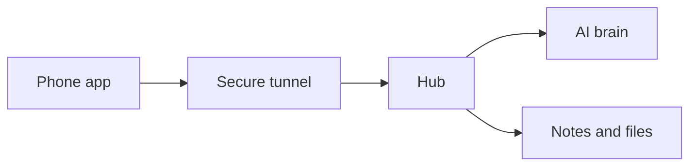
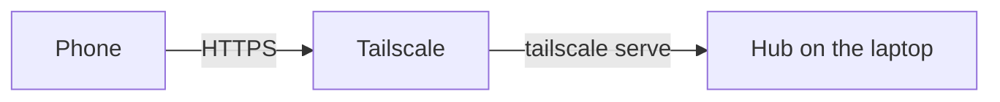

# 02 · How it works

**What this page is for:** the five moving parts in simple words, where your data lives, and what stays private.

## The five pieces

| Piece | Think of it as | What it really is |
|---|---|---|
| **Hub** | The brain and hands, at home | A Python program running on your laptop |
| **Phone app** | The remote control | An Android app that shows the hub's web pages |
| **Secure tunnel** | A private road | Tailscale, with HTTPS in front |
| **AI brain** | A helper you can call | Local model, Gemini or Claude |
| **Notes and files** | Your notebook and drawers | Normal files and small databases on the laptop |

## 1. The hub

- Starts with `python -m hub serve`.
- Listens only on the laptop itself (`127.0.0.1`, port `8765`). Nothing on your Wi-Fi can reach it directly.
- Handles login, files, notes, the terminal, the assistant, reminders and more.
- Keeps a log of important actions (logins, approvals, commands).

> ✅ **Check:** If the hub window is closed, the app stops working. Auto-start (page 08) fixes that.

## 2. The phone app

- Built with Capacitor. It is a thin Android shell around the hub's own web page.
- All the logic stays on the laptop. The phone only draws screens.
- Extra phone powers: microphone, file downloads, and reading payment, Gmail and Chat notifications (only the ones you allow).
- It remembers screens so it can open even if the laptop is off. It then tells you it cannot reach the laptop.

## 3. The secure tunnel

- Tailscale makes a private network of only your own devices.
- `tailscale serve --bg 8765` puts a secure `https://...ts.net` address in front of the hub.
- Android needs HTTPS for the **microphone** and for installing the app. That is why the address matters.
- Your address: `https://shikharonestack.tail3ffc35.ts.net`

## 4. The AI brain

The hub does not think by itself. When it needs to, it asks one of these:

| Brain | Where it runs |
|---|---|
| Local model (Ollama) | On your laptop |
| Gemini | Google's servers |
| Claude (your login) | Anthropic's servers, through the `claude` program |
| Claude (API key) | Anthropic's servers |
| Claude + Gemini duo | Both, in teams |

Full comparison on page 04.

## 5. Notes and files

Where things live on the laptop (replace `YOU` with your user name):

| What | Where |
|---|---|
| Settings and token hash | `C:\Users\YOU\.laptop-hub\hub.json` |
| Activity log | `C:\Users\YOU\.laptop-hub\audit.log` |
| Update log | `C:\Users\YOU\.laptop-hub\update.log` |
| App data (search index, to-dos, trash, backups, Friday, council jobs) | `C:\Users\YOU\.laptop-hub\data\` |
| Your notes (plain `.md` files) | `C:\Users\YOU\HubNotes` |
| Files you upload from the phone | `C:\Users\YOU\HubInbox` |
| Gmail, calendar, Chat and Gemini secrets | Windows keyring (Credential Manager) |
| Asana token | `C:\Users\YOU\.claude\.asana_token` |
| The code | The folder you cloned, for example `D:\laptop-hub` |

> ✅ **Check:** Your notes are plain files. You can open them in any editor, and they also show up in the **Files** screen.

## What is private

| Stays on the laptop | Leaves the laptop only when you choose it |
|---|---|
| Notes, files, search index | Text you send to **Gemini** or **Claude** goes to their servers |
| Local AI (Ollama) answers | **Phone push** goes through the public ntfy.sh service |
| Voice to text (Whisper) | Asana, Gmail and calendar calls go to those services |
| Your login token (only its hash is stored) | The first voice recording downloads the Whisper model once |
| Secrets (in the Windows keyring) | |

> ⚠️ **Careful:** Choosing **Local model** is the only way to keep a request fully on the laptop. See page 10 for more.
