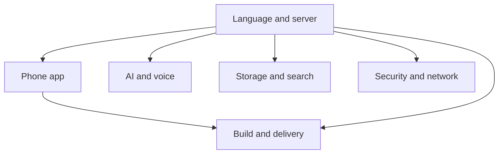

# 03 · Technologies explained

**What this page is for:** a friendly glossary of every tool and library in the project. Look things up here when a word confuses you.

How to read it: each card says **what it is**, **why it is here**, and **where you meet it**. You do not need to learn any of them to use the app.

## 1. Language and server

| Name | What it is | Why it is here | Where you meet it |
|---|---|---|---|
| **Python** | A popular programming language. | The whole hub is written in it. | `python -m hub ...` commands |
| **FastAPI** | A Python toolkit for building web servers. | It receives every tap from the phone and answers. | Runs silently inside the hub |
| **uvicorn** | A program that runs a FastAPI server. | It is the engine that listens on port 8765. | Started by `python -m hub serve` |
| **pydantic** | Checks that incoming data has the right shape. | Stops bad or odd requests early. Installed with FastAPI. | Never directly |
| **httpx** | A Python tool for calling other web services. | The hub uses it to talk to Ollama and Gemini. | Never directly |
| **python-multipart** | Reads file uploads. | Needed when you upload a file from the phone. | Files, Notes with audio |
| **psutil** | Reads facts about the computer. | Shows running programs, battery, disk and memory. | Laptop screen, assistant |
| **venv (`.venv`)** | A private box of Python packages for one project. | Keeps this project's packages away from the rest of your PC. | `.venv\Scripts\activate` |
| **pip** | Python's package installer. | Installs everything in the `requirements-*.txt` files. | `pip install -r ...` |
| **PowerShell** | The Windows command window. | Where you type the commands in these pages. | Start menu |
| **winget** | The Windows app installer. | Installs Git, Python, Tailscale and Ollama in one line. | Setup |

## 2. Phone app

| Name | What it is | Why it is here | Where you meet it |
|---|---|---|---|
| **Capacitor** | A kit that wraps a web page into a real Android app. | Gives REDLINE an app icon, microphone permission and native add-ons. | `mobile/` folder |
| **Android app (APK)** | The installable file for Android. | This is what you put on your phone. | Built by GitHub, installed by hand |
| **WebView** | The browser part inside an Android app. | The app shows the hub's pages in it. | Invisible |
| **Debug signing key** | A throwaway "signature" on test builds. | Android refuses to install a new build over an old one, so you uninstall first. | "App not installed" error |
| **Android notification listener** | A permission that lets an app read notifications. | Lets REDLINE see payment, Gmail and Chat alerts you allow, and send them to your hub. 🟡 Not tested on real devices yet. | Settings, Phone capture |
| **SMS receiver** | An optional permission to receive text messages. | Optional bank-SMS capture. It cannot read your inbox. | Settings, Phone capture |
| **Download manager** | Android's built-in downloader. | Saves files from the Files screen to your Downloads folder. | Files, download |
| **PWA (web app)** | A website you can install like an app. | Lets you use REDLINE from Chrome without the APK. | Chrome, Install app |
| **Service worker (`sw.js`)** | A helper script in the browser. | Keeps the app's shell so it opens even if the laptop is off. | Invisible |
| **Web manifest** | A small file naming the app and its icons. | Gives the app its name "REDLINE" and its icon. | Home screen icon |
| **JavaScript (no build step)** | The language of web pages. | Each screen is one plain file in `hub/static/js`. Easy to edit. | Invisible |
| **WebSocket** | A live, two-way connection. | Keeps the Terminal screen typing in real time. | Terminal |
| **Server-sent events (SSE)** | A one-way live stream from the server. | Streams AI answers and notifications as they happen. | Talk, Notifications |
| **MJPEG** | A stream made of many small pictures. | Shows your laptop screen live. | Remote screen |
| **MediaRecorder** | A browser tool to record the microphone. | Records your voice for notes and Talk. | Notes, Talk |
| **marked and DOMPurify** | A text formatter and a safety filter. | Show Markdown nicely and strip anything dangerous from it. Bundled in the app. | Notes, chat answers |
| **xterm.js** | A terminal drawn in a web page. | The black terminal window on your phone. Bundled in the app. | Terminal |
| **Inter and JetBrains Mono** | Two fonts. | The look of REDLINE. Bundled, so no internet needed. | Everywhere |

## 3. AI and voice

| Name | What it is | Why it is here | Where you meet it |
|---|---|---|---|
| **Ollama** | A free program that runs AI models on your own laptop. | The private, offline AI brain. | Local model option |
| **qwen3:4b** | A small AI model (4 billion "parameters"). | The default local model. Small enough for a laptop without a strong graphics card. | `ollama pull qwen3:4b` |
| **nomic-embed-text** | A model that turns text into numbers for "meaning search". | Lets **Ask my files** find things by meaning. Without it you get keyword search. | `ollama pull nomic-embed-text` |
| **Whisper / faster-whisper** | A speech-to-text model and its fast Python version. | Turns your voice into text on the laptop. Audio never leaves it. | Notes, voice mode |
| **Gemini** | Google's AI, used through a free API key. | Cheap everyday cloud brain, separate from your Claude limits. | Setup, AI choice |
| **Claude (API key)** | Anthropic's AI, billed per use. | Optional strong brain. Uses `ANTHROPIC_API_KEY`. | AI choice |
| **Claude Code (`claude`)** | Anthropic's command-line app. | Lets the hub use your **Claude subscription login** without an API key. | "Claude (my login)" |
| **`anthropic` library** | Anthropic's Python kit. | Talks to Claude when an API key is set. | Never directly |
| **API key** | A password for a service's API. | Proves you may use Gemini or Claude. | Setup wizard |
| **Embeddings** | A list of numbers that stands for the meaning of text. | The trick behind meaning search. | Ask my files |
| **Tool calling** | The AI asks the hub to run a small action. | How the assistant opens files or writes notes, after your approval. | Talk |
| **Text-to-speech** | The phone reads text aloud. | Friday and voice mode speak using the phone's own voice. | Voice mode |

## 4. Storage and search

| Name | What it is | Why it is here | Where you meet it |
|---|---|---|---|
| **SQLite** | A database stored in one file. | Keeps your search index, spending and small data. No server needed. | `.laptop-hub\data` |
| **FTS5** | SQLite's built-in full-text search. | Fast keyword search with ranking (BM25) for Ask my files. | Ask my files, Search |
| **Markdown (`.md`)** | Plain text with simple marks like `#` for headings. | Your notes are saved this way, so any editor can open them. | Notes |
| **JSON (`hub.json`)** | A simple text format for settings. | Your hub's settings file. | `.laptop-hub\hub.json` |
| **pypdf** | A Python tool that reads PDFs. | Lets Learn make quizzes from a PDF. | Learn |
| **Trash folder** | A holding area for deleted files. | Deleting in Files moves things here so you can restore them. | Files |
| **Zip backup** | One compressed file with your data. | A one-tap backup (newest 5 are kept). | Settings, Backups |

## 5. Security and network

| Name | What it is | Why it is here | Where you meet it |
|---|---|---|---|
| **Tailscale** | A private network between your own devices. | The only way into the hub. Nothing is open to the internet. | Tray icon, phone app |
| **`tailscale serve`** | A Tailscale command that adds HTTPS. | Gives the hub a secure `https://...ts.net` address. | Setup |
| **MagicDNS** | Friendly names for your devices. | Makes the address a readable name. | Tailscale admin page |
| **HTTPS** | The secure version of web addresses. | Android needs it for microphone and install. | The address starts with `https://` |
| **Login token** | One long random password for the app. | The only key to your hub. Only its hash is stored. | First login |
| **Hash (SHA-256)** | A one-way scramble. | The hub can check your token without keeping it. | Invisible |
| **Session cookie** | A small signed note your phone keeps after login. | Keeps you logged in for 14 days. | Invisible |
| **Windows keyring** | Windows' safe for secrets. | Stores Gmail, calendar, Chat and Gemini secrets. | Setup wizard |
| **App password** | A special Gmail password for one app. | Lets the hub read mail without your real password. | Setup, Gmail |
| **Approval card** | A box showing exactly what will run. | You must tap Approve before the assistant changes anything. | Talk |
| **Audit log** | A diary of important actions. | Lets you see who did what and when. | Settings, Activity log |
| **ntfy** | A free service that sends phone push messages. | Optional push when the app is closed. Its topics are public, so use a long random one. | Settings, Phone push |
| **Cloudflare WARP** | A VPN app. | Optional button for reaching a company system. 🟡 Not tested on real devices yet. | Setup, WARP step |

## 6. Build and delivery

| Name | What it is | Why it is here | Where you meet it |
|---|---|---|---|
| **Git** | Tracks versions of code. | Downloads and updates the project. | `git clone`, `git pull` |
| **GitHub** | A website that stores the code. | Holds the repo `ShikharGupta0813/laptop-hub` and builds the app. | github.com |
| **GitHub Actions** | GitHub's built-in robot workers. | The "Build Android APK" workflow builds the phone app in the cloud. | Actions tab |
| **Workflow file** | Instructions for the robot. | `.github/workflows/android-apk.yml`. | Repo |
| **Node.js and npm** | A JavaScript runtime and its installer. | Capacitor needs them to build the app (Node 22). | Only when building |
| **Gradle, Java, Android SDK** | The Android build tools. | Turn the code into an APK. GitHub has them, so you do not. | Only when building yourself |
| **Task Scheduler** | Windows' automatic job runner. | Starts the hub at login (`LaptopHub`) and runs the updater (`LaptopHubUpdate`). | Setup, autostart |
| **`python -m hub update`** | The built-in updater. | Pulls new code from GitHub safely. | Update REDLINE button |
| **unittest** | Python's test runner. | Runs over 1,300 automatic checks. | For developers |
| **Playwright** | A tool that drives a browser by script. | Used by developers to check screens. Not part of the app. | For developers |

## 7. Neighbours: other projects it works with

| Name | What it is | Why it matters |
|---|---|---|
| **Jarvis** (`jarvis-voice-assistant`) | Your Windows voice assistant. | The hub reuses its mail, calendar and chat helpers. Optional. |
| **multi-llm-lab** | Your multi-model council project. | The Council screen runs it. Optional. |
| **Asana** | A task manager. | The Work screen shows your tasks. Needs a personal access token. |
| **Google Chat webhooks** | A way to post into a Chat space. | Lets Work post to a space. It cannot read Chat. |
| **iCal link** | A private link to a calendar. | Lets the hub read today's meetings. |

> ✅ **Check:** Not sure what a word means? Search this page first. If it is missing, ask Claude to "explain `WORD` in simple terms".
