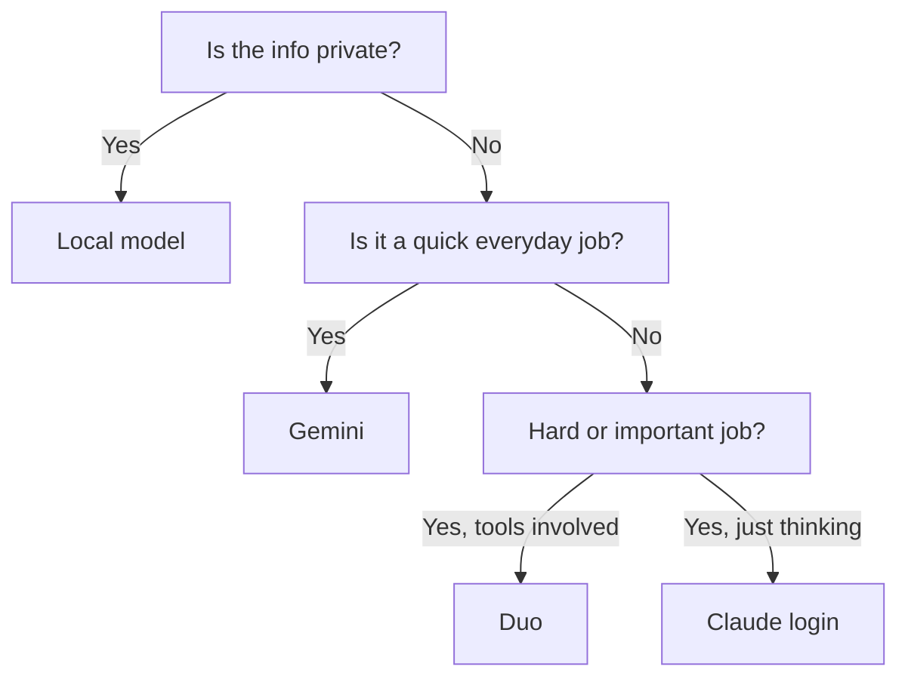
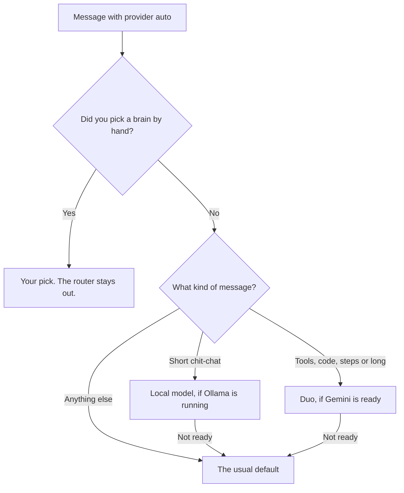
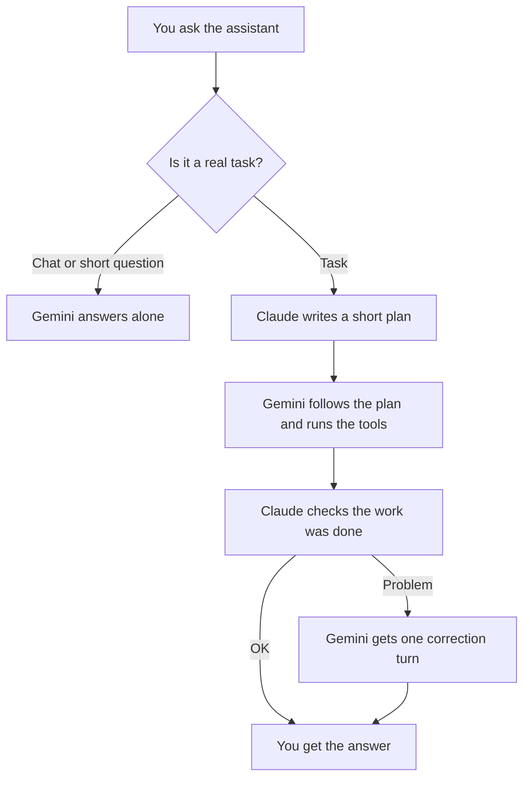

# 04 · AI brains

**What this page is for:** the five AI choices, what each costs, how to pick one, how to set keys safely, and what to do when a quota runs out.

## The five choices

| Brain | What it is | Needs |
|---|---|---|
| **Local model** | Ollama running a small model on your laptop. | Ollama installed, `qwen3:4b` downloaded |
| **Claude (API key)** | Anthropic's AI, billed per use. | `ANTHROPIC_API_KEY` |
| **Claude (my login)** | Claude through the `claude` program, using your Claude subscription. | Claude Code installed and logged in once |
| **Gemini** | Google's AI with a free API key. | A free key from aistudio.google.com/apikey |
| **Claude + Gemini (duo)** | Claude plans and checks. Gemini does the work. | A Gemini key. Claude Code login is a bonus. |

> ✅ **Check:** You see only the brains that are **ready**. If one is missing from the picker, it is not set up yet.

## Compare them

| | Local | Claude API | Claude login | Gemini | Duo |
|---|---|---|---|---|---|
| **Cost** | Free | Pay per use | Uses your subscription quota | Free tier, then limits | Free tier plus a little Claude quota |
| **Quota** | None | Your billing limit | Shared with your other Claude work | Daily and per-minute limits | Gemini limits, plus up to 20 Claude calls per hour |
| **Speed** | Slowest here (laptop has no strong GPU) | Normal | Normal, starts a program each time | Normal | Slower: up to two extra Claude calls |
| **Best for** | Private and small jobs | Heavy jobs if you have a key | Heavy jobs, no key needed | Everyday jobs | Assistant jobs with tools |
| **Private** | Yes, stays on laptop | No, goes to Anthropic | No, goes to Anthropic | No, goes to Google | No, goes to both |
| **Needs internet** | No | Yes | Yes | Yes | Yes |

> ⚠️ **Careful:** These are design facts from the code. Real speed and quality on your laptop are 🟡 not tested on real devices yet, especially Claude login on Windows and the duo.

## How to choose



Simple rules:

1. **Private or offline:** Local.
2. **Everyday jobs** (note titles, quick questions, Friday brief): Gemini. It protects your Claude quota.
3. **Big jobs:** Claude login. Pick it by hand.
4. **Assistant jobs that use your laptop:** Duo.

## The "auto" setting

The default is **auto**. It picks the first one that is ready, in this order:

1. Claude API key
2. Gemini
3. Claude login
4. Local model

`auto` never picks the duo by itself. You choose that on purpose.

### The router

Since the router arrived, `auto` also looks at each message before it picks. It reads the words only. It does not ask any AI, so it costs nothing.



The reply carries a small note saying where it went (`routed_to`), and Settings status shows the last decision. Turn it off with `"router_enabled": false` in `hub.json` to get the old behaviour.

If the local model fumbles a tool call twice in a row, Gemini does that one step instead and you see a note. It never switches to Claude by itself. Turn it off with `"tool_failover": false`.

## How the duo works



Rules in the code:

| Rule | Value |
|---|---|
| Plan length | About 120 words, one Claude call |
| Check length | About 80 words, one Claude call |
| Corrections | At most one |
| Hourly Claude cap | `duo_max_claude_per_hour`, default 20. Set 0 to never ask Claude. |
| Claude call timeout | 25 seconds |
| Check on or off | `duo_verify`, default on. Turn off to save quota. |
| If Claude fails | Pause (30 minutes on usage limit). Gemini carries on alone. |

> ✅ **Check:** When Claude is paused, Settings shows a note like "Claude supervisor paused: usage limit". That is normal. Your work still gets done.

## Set keys safely

Never type a key into chat, notes or a screenshot. Use the wizard. It hides what you type and stores keys in the Windows keyring.

**Gemini key** (free):

1. Go to aistudio.google.com/apikey. Sign in. Press **Create API key**.
2. On the laptop run:

```powershell
python -m hub setup --only gemini
```

3. Paste the key when asked. Nothing shows on screen. That is on purpose.

**Claude login** (no API key):

1. Install Claude Code from claude.com/claude-code.
2. Open a terminal, run `claude` once and sign in.

**Choose your default brain:**

```powershell
python -m hub setup --only ai
```

It explains the options, checks Claude Code, offers the Gemini step, and recommends the duo when both are ready.

Check what is ready:

```powershell
python -m hub doctor
```

> ⚠️ **Careful:** An `ANTHROPIC_API_KEY` is billed separately from a Claude subscription. You do not need one. If you set one, the hub picks it first under **auto**. Set it only through Windows "Edit environment variables for your account", never in a chat.

## When a quota runs out

| What you see | What it means | What to do |
|---|---|---|
| "Your Claude usage limit is reached for now" | Your Claude subscription window is used up. | Wait for it to reset, or pick Gemini or Local. |
| "This key's free tier has no quota for the available models" | Google gives your key a limit of 0. | Make a new key in a fresh AI Studio project, or turn on billing, or use Claude login or Local. |
| "Gemini's free quota is used up for now" | A normal daily or per-minute limit. | Wait a minute, or until tomorrow, or pick another brain. |
| "Gemini doesn't know that model" | The model name is wrong or retired. | See below. |
| "The Gemini API key was rejected" | The key is wrong or deleted. | Make a new key, then run the Gemini setup again. |

> ⚠️ **Careful:** A **Google AI Pro subscription does not include API quota.** The API key is a separate thing.

The hub already helps: if a Gemini model returns "not found" or "no quota", it moves to the next stable model on its own and remembers the bad one for a day.

To pick a specific Gemini model, set `gemini_model` in `hub.json` (default `gemini-2.5-flash`). A Pro name, for example `gemini-2.5-pro`, is allowed. Restart the hub after editing.

## Where each brain is used

| Feature | Which brain |
|---|---|
| Talk (assistant) | The one you pick on the screen, or the default |
| Friday brief | `brief_model` in Friday settings ("Brain for briefs") |
| Note titles and tags, quick questions | The default brain |
| Ask my files | Ollama with `nomic-embed-text` for meaning search. Keyword search works without it. |
| Voice to text | Whisper, always on the laptop |
| "Ask about my screen" | Needs the Claude API key (it sends screenshots) |
| Council | Its own models. Claude is off unless you allow it. |

> ✅ **Check:** Switch to **Local** any time you want a request to stay on the laptop.
