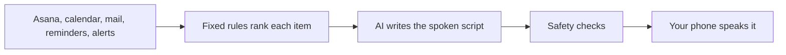

# 05 · Friday, your daily assistant

**What this page is for:** what Friday does, how to use it each morning, how to connect Gmail, Asana and your calendar, and what it cannot do.

> ⚠️ **Careful:** Friday works with real accounts (Asana, Gmail, calendar). That part is 🟡 not tested on real devices yet. Friday and its logic were tested with fake data only.

## What Friday is

Friday is a friendly voice and screen for your day. It gathers what matters, ranks it with fixed rules, and then says it out loud in about 15 to 45 seconds.

| Feature | What it does |
|---|---|
| **Brief me** | A spoken summary: what needs you now, tasks, meetings, mail, reminders. |
| **Plan my day** | Fits your tasks into the free time between meetings. |
| **Get laptop ready** | Suggests what to open on the laptop for today. You approve before anything opens. |
| **Alerts** | Optional. Tells you when you were tagged, a task turns urgent, or a meeting is about to start. |

## Where you find it

- **Home** has a Friday card with **Brief me** and a microphone button.
- **Talk** has a Friday chip.

## How a brief is made



Important points:

- **Rules decide the order, not the AI.** An overdue task or a meeting starting soon always comes first.
- The AI only writes the sentences. If its text fails a check, a plain template script is used instead.
- Text from mail, Asana and chat is treated as **data**, never as instructions.
- For mail, Friday sees only the **sender and subject**. Never the body.

The brief groups items in this order, and only if something is there:

1. Needs you now
2. Tagged
3. Tasks
4. Meetings
5. Mail
6. Chat
7. Reminders
8. Other

## Daily use

1. Open **Home**.
2. Tap **Brief me**. Listen.
3. Say or tap **Plan my day**.
4. Review the blocks. Tap **Add to my to-dos** if you like them.
5. Tap **Get laptop ready** if you want things opened. Choose which items, then **Approve and open on laptop**.

> ✅ **Check:** "Add to my to-dos" creates to-dos and reminders only. It never changes Asana or your calendar. Nothing is sent to anyone.

> ⚠️ **Careful:** Laptop prep proposals expire after 12 hours. Only web links, files in your shared folders, and apps from your own list can be proposed.

## Settings

Open Friday, then its settings.

| Setting | Meaning |
|---|---|
| Name and how to address you | Default name is Friday. If you never change the address, Friday uses the name you gave the setup wizard (default "Chief"). |
| **Speak alerts** | Reads alerts aloud. |
| **Keep watch for me** | Turns on background alerts. Off until you switch it on. |
| **Brain for briefs** | Which AI writes the script. Default is "auto", your default brain (page 04). |
| Quiet hours | No notifications in this window. Alerts are still saved. |
| Work hours | Defaults 09:00 to 18:30. Used by the day plan. |
| Prep apps and folders | Which apps and shared folders laptop prep may suggest. |

## Alerts, when switched on

The hub checks every 3 minutes.

| Alert | When |
|---|---|
| **Tagged** | Someone @mentions you, or comments on one of your open Asana tasks. |
| **Priority** | A task newly becomes due today, overdue or high priority. |
| **Meeting** | A meeting starts in about 10 minutes. |

At most 5 push notifications per round. The rest are batched into one "and N more".

## Connect your accounts

Run the wizard. Each step is optional and asks first.

```powershell
python -m hub setup
```

Or one step at a time:

```powershell
python -m hub setup --only jarvis
```

```powershell
python -m hub setup --only asana
```

```powershell
python -m hub setup --only gmail
```

```powershell
python -m hub setup --only calendar
```

```powershell
python -m hub setup --only chat
```

| Account | What you need | Where it is stored |
|---|---|---|
| **Jarvis folder** | The wizard can download it for you. Calendar, email sending and Chat posting use its helper files. | `jarvis_dir` in `hub.json` |
| **Asana** | A personal access token from app.asana.com/0/my-apps | `C:\Users\YOU\.claude\.asana_token` |
| **Gmail** | 2-Step Verification on, then an **App password** from myaccount.google.com/apppasswords | Windows keyring |
| **Calendar** | The secret iCal link of your calendar (ends in `.ics`) | Windows keyring |
| **Google Chat** | A webhook URL from a Space (Apps and integrations, Webhooks) | Windows keyring |

> ⚠️ **Careful:** Company Google accounts often have App passwords or IMAP turned off by the admin. Then Gmail login is refused and only your admin can change it. A personal Gmail works without help. The Inbox and Watch read one app-password mailbox; a **second account (for example your company one)** is connected with Google sign-in instead, see the next section.

## Connect a second Gmail account (company)

The first mailbox (your app password above) shows up in Settings as **Gmail accounts, personal**. A company mailbox is added next to it with Google sign-in, so it needs no app password and no IMAP switch. It is **read-only** unless you turn sending on.

1. **Create an OAuth client once** (about 5 minutes) at console.cloud.google.com: new project, *APIs and services*, enable the **Gmail API**, then *OAuth consent screen* (choose **Internal** if the account is a Google Workspace one and you are its user; otherwise **External**), then *Credentials, Create credentials, OAuth client ID, type **Desktop app***. Copy the client id and secret.
2. If the consent screen is **External** and in *Testing*, add the company address under **Test users**. Otherwise Google refuses the sign-in ("access blocked"). Testing-mode sign-ins expire after 7 days; publish the app to stop that. A Workspace admin may also have to allow the app (Admin console, Security, API controls); if sign-in is blocked, ask them.
3. In REDLINE: **Settings, Gmail accounts, Connect another account**. Label it `company`, paste the client id and secret (saved in the Windows keyring), press **Open Google sign-in**, and approve **View your email messages and settings** only. The page then says "Connected". If the phone is not the laptop, open the sign-in link on the laptop; if the final page cannot be reached, copy its address into **Finish with pasted address**.
4. The card lists what Google really granted. Sending needs the extra **Allow sending from this account** switch and a fresh consent (press **Re-consent**).

> ⚠️ **Careful:** Company mail is treated as protected. With **Allow company mail to reach cloud AI** off (the default) the text of company mail is never sent to Gemini or Claude, only sender, subject and Gmail's short snippet, and only the local model reads a body. Ask your company (for example OneStack's policy) before switching it on. 🟡 Not tested against real Google accounts yet.

> ⚠️ **Careful:** Chat webhooks can **post** into a Space. They cannot **read** Chat, and they cannot send direct messages. To read Chat, use the Android app's notification capture (Settings, Phone capture, Watch chat). 🟡 Not tested on real devices yet.

## Full Control mode (optional, off by default)

Normally the assistant stops and asks you to tap Approve before it runs a command, writes a file or does anything
else that changes your laptop. **Full Control** removes that step: when you say "run git pull" (or the assistant or
Friday decides to), it just goes. Turn it on in Settings > Account and security > Full Control.

- **What it does.** Every approval is granted automatically, for every tool, including `run_command`, file writes,
  saved scripts, email and chat sends, and Friday's "open on laptop". With `fast_commands` on (the default), clear
  messages such as "run git status", "open Chrome" (an app in your list, or a link) or "type hello" skip the AI
  completely and run at once. Typed messages and spoken ones behave the same.
- **Names.** "Jarvis, ..." talks to the laptop operator, "Friday, ..." to the day assistant, by voice or typing.
- **What it does not do.** The hub's own settings and audit log (`~/.laptop-hub`) still cannot be written by the
  assistant, and credential folders (`.ssh`, `.aws`...) still cannot be read by it. Typing keystrokes still needs
  remote control armed in Apps > Screen.
- **The risk.** While it is on, anyone holding your unlocked phone with the app open controls your laptop, and a
  confused or manipulated AI can run a harmful command with nothing to stop it. A red FULL CONTROL chip sits in the
  header the whole time.
- **Turning it on and off.** On needs you to type `I UNDERSTAND` (the hub checks it too). Off is one tap on the chip
  or the Settings row. Every automatic action is written to the audit log with `"full_control": true`.

## Limits, honestly

| Limit | Detail |
|---|---|
| "Hey Friday" only while the app is open | The wake word works only while the app is open and the screen is on (Android stops the microphone in the background). A true always-on wake word needs a native Android service. See "Hands-free" below. |
| "Tagged" is narrow | It means @mentions and others' comments on your open or followed tasks. |
| Calendar needs setup | Without the Jarvis folder or an iCal link, the calendar part shows a 503 error. The rest of Friday still works. |
| Failed sources | If one source fails, Friday lists it and uses the rest. |
| Voice on the phone | Hands-free voice mode is 🟡 not tested on real devices yet. |

## Hands-free: "Hey Jarvis" and "Hey Friday"

Switch on **Settings > Appearance > Hey Jarvis / Hey Friday** and you can start voice mode by just talking: say
"Hey Jarvis, remember that the RCA was a bad deploy" or "Hey Friday, what's my day". You hear a short chime (lower for
Jarvis, higher for Friday), voice mode opens (cyan orb for Jarvis, amber for Friday) and whatever you said after the
name is sent straight away. Say only "Hey Jarvis" and it opens and listens. A small chip under the top bar says
"Listening for Hey Jarvis or Hey Friday" while it is on.

It is **off by default**, because it keeps the microphone open (privacy and battery). It uses Chrome's own speech
recognition, so it only works while the app is open and the screen is on; Android stops it in the background. It needs
the secure (https) address and the microphone permission. Under the hood: `js/wakephrase.js` (matching, tested with
node), `js/wake.js` (the listener, chip and chime), `voicemode.js` `setPreload()` (hands over the words).

**Keep the screen on.** Android stops the microphone when the screen turns off, so with the wake word on, REDLINE asks the browser to keep the
screen awake while it listens and the page is visible (the Screen Wake Lock API; it lets go when you leave the app or switch the wake word off).
That uses battery. Turn it off with **Settings > Appearance > Keep screen on while listening**. Browsers without the feature simply skip it.

### At the desk: the laptop microphone

Switch on **Settings > Appearance > Listen on the laptop microphone** and the hub itself listens on the laptop: say "Hey Jarvis, what's on my plate"
and hear the answer from the laptop speakers, phone untouched. It is off by default and needs the optional `sounddevice` package
(`pip install sounddevice`) plus a microphone; without them the switch shows a plain message instead of failing. **Privacy:** the audio never leaves the
laptop (the local Whisper model reads it), only the text of a wake sentence goes to the AI you chose, and everything else it hears is thrown away
at once. Changes that need approval still wait for you on the phone, and you get a push. Details: `docs/api/wakeword.md`.
### Always-on, even with the screen off (Android app only)

The browser version above only works while the app is open. The Android app can do more: open **Settings** and find
**Always-on Hey Jarvis (background)**. Press the download button once (about 40 MB, best on Wi-Fi), then switch it on and
say yes to the microphone and notification questions. From then on the phone listens quietly, even with the screen off, and
when you say "Hey" and the name of one of your assistants (Jarvis, Friday, or the ones you renamed or added in Settings, Assistants) it buzzes and opens voice mode. The phone learns new names when you open the app, so open it once after changing an assistant (you also need the newest app build). Unusual names are heard less reliably; add "variants" for a name that gets missed. A notification tells you it is listening, with a
**Stop** button.

Your voice is recognised on the phone itself. Nothing you say is recorded or sent anywhere; only the words after "Hey
Jarvis" reach your hub, just like typing them. It uses some battery, so switch it off if you do not need it. After a restart
of the phone you have to open the app and switch it on again (Android does not allow it to start by itself). If the app
does not pop open on its own, tap the notification. Details: `mobile/README.md`, "Hey Jarvis in the background".
