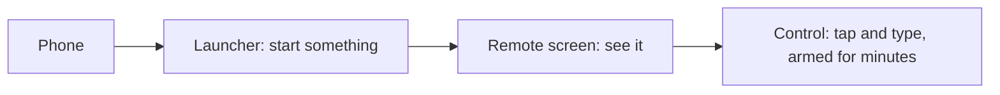
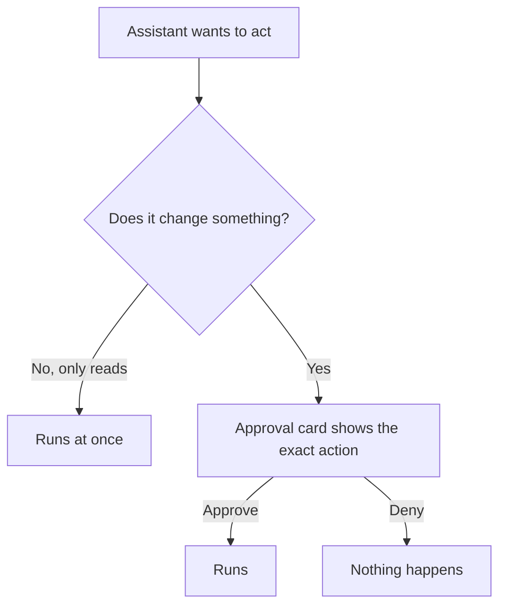

# 06 · Controlling your laptop

**What this page is for:** how to start apps, see the screen, use the terminal and files from the phone, how the Update button fits in, what asks for approval, and what fails when the laptop is locked or asleep.

> ⚠️ **Careful:** The Windows parts (terminal, lock, volume, screenshots, starting apps, touch control) are mostly 🟡 not tested on real devices yet. The Terminal, Talk, Learn and Files screens did show up on the first real run.

## The tools at a glance

| Tool | Find it | Use it to |
|---|---|---|
| **Launcher** | Apps | Open an app, folder or link on the laptop |
| **Remote screen** | Apps | Watch the laptop screen. Optionally control it. |
| **Terminal** | Apps | Type commands in PowerShell, WSL or cmd |
| **Files** | Apps | Browse, read, edit, upload, zip, trash files |
| **Laptop** | Apps | Status, quick buttons, upload, log out |
| **Talk** | Bottom bar | Ask the assistant to do things for you |



## Launcher

Start anything without touching the laptop.

1. Open **Apps**, then **Launcher**.
2. Tap a big app tile, or search your installed apps.
3. A box asks "Start this on your laptop?" Tap **Start**.
4. You land on the **Remote screen**, with a **Control** button.

Other things the Launcher does:

- **Use my whole laptop:** shows the screen. Nothing is started.
- **Open a folder** from your shared folders.
- **Open a link** in the laptop's browser.
- **Open windows:** list what is open.
- **Workspaces:** one tap runs several steps (scripts, links, apps, folders, waits).

> ✅ **Check:** The launcher only starts apps from its own list (Start Menu shortcuts and your `apps` in `hub.json`). It never runs a path typed from the phone.

## Remote screen

| Mode | What you can do | How it is protected |
|---|---|---|
| **View** | Watch the screen live | Needs only your login |
| **Control** | Tap, type, drag, press keys | Off until you arm it. Self-switches off after 1 to 15 minutes. |

To control the screen:

1. Open **Remote screen**.
2. Tap **Enable control**. Confirm. Choose minutes (default 5).
3. Choose **Trackpad** or **Direct touch**.
4. Use the key buttons for Esc, Tab, Alt+Tab, Ctrl+C and more. Use **Paste to laptop** for text.
5. Tap **Disarm now** when done.

> ⚠️ **Careful:** Armed control means your phone can click and type as you. Keep the window short. Every control action is written to the activity log.

Limits: one live stream at a time, and a stream stops after 10 minutes (open it again). Touch control and streaming are 🟡 not tested on real devices yet.

It needs an extra install on the laptop:

```powershell
pip install -r requirements-screen.txt
```

Then restart the hub.

## Terminal

- Real shells: PowerShell, WSL and cmd.
- On Windows it needs `pywinpty`, which `requirements.txt` installs.
- The hub does **not** record what you type here. It records only that a session opened and closed.
- If the connection drops, the screen shows a reconnect banner.

> ⚠️ **Careful:** The Terminal is full access. It can do anything you can do on the laptop. There are no approval cards here. Lock your phone.

## Files

- You see only the folders you chose when you ran `init` (called "roots").
- Files are **read-only** except in folders listed in `writable_roots` (default: `notes` and `inbox`).
- Deleting moves the item to a **trash** you can restore from. Nothing is gone for good until you empty the trash.
- Opening a PDF in the Android app downloads it. Tap the download button.

To allow edits in another folder, add its name to `writable_roots` in `hub.json`, then restart the hub.

## Update REDLINE

A button that updates the hub without opening a terminal.

1. Open **Apps**, then **Laptop**, then **Quick buttons**.
2. Tap **Update REDLINE** and confirm.
3. Wait about 20 seconds. The app reconnects.

Details and the one-time setup are on page 08.

## Laptop actions

You can run these from Apps or ask the assistant.

| Action | Asks you first? |
|---|---|
| System info, battery, disk space, network, uptime | No |
| List running programs | No |
| End a program | Yes |
| Open a web address | No (the Launcher and Friday still confirm first) |
| Open a file or folder | Yes |
| Screenshot | No |
| Read or set the clipboard | No |
| Volume, mute, play, pause, next, previous | No |
| Lock the screen | No |
| Sleep | Yes |
| Restart and shut down (30 second delay) | Yes |
| Cancel shutdown | No |

> ⚠️ **Careful:** Putting the laptop to sleep from the phone makes the hub unreachable until you wake the laptop by hand. Use **Cancel shutdown** within 30 seconds if you change your mind.

## What approvals protect



| Part | Needs approval? |
|---|---|
| Assistant: write file, run command, open app, send | Yes, every time |
| Assistant: "Run commands without asking" switch | Turns approvals off **for this session only** |
| Routines: dangerous steps | Need your explicit confirmation |
| Remote control | Needs arming each time |
| Terminal | No cards. Full access. |
| Quick buttons | A confirm box before running |

> ✅ **Check:** The "Run commands without asking" switch resets when the hub restarts.

## When the laptop is locked, asleep or off

| State | What happens |
|---|---|
| **Awake and unlocked** | Everything works. |
| **Locked** | The hub keeps running, so Talk, Notes and Files should still answer. Screenshots and remote control of a locked Windows screen are 🟡 not tested. Unlock first. |
| **Asleep or hibernating** | The hub stops answering. The app says it cannot reach your laptop. |
| **Lid closed** | Usually sleeps. Change this in Windows Power Options if you need it awake. |
| **Off or restarting** | Nothing works until it is back **and you have logged in** (auto-start runs at login). |
| **No internet or Tailscale off** | The app cannot find the laptop. |

Keep the laptop reachable (plugged in, no sleep on power):

```powershell
powercfg /change standby-timeout-ac 0
```

```powershell
powercfg /change hibernate-timeout-ac 0
```

> ⚠️ **Careful:** REDLINE has no wake-up feature for a sleeping laptop. Plan for it: plug in, and set sleep to never while charging.
