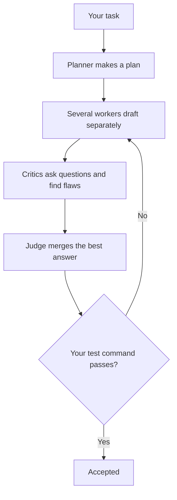
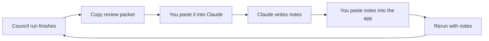

# 07 · The Council in the app

**What this page is for:** how to start a council run from your phone, read the result, turn models on and off, and use the review-packet loop with Claude.

> ⚠️ **Careful:** The Council screen was built against a fake lab. It has **not been tested with the real multi-llm-lab on a real laptop yet**. A few flag names and output fields are unverified. Expect small fixes on the first real run.

## What the council is

The council is your `multi-llm-lab` project. Several **different** AI models work on one task like a small team. They draft, question each other, and a judge picks the best. If you give a test command, your tests decide the final answer.

It is meant for side jobs, so you do not spend Claude on them.



> ✅ **Check:** Models can agree on the same wrong answer. Tests are what close the gap. For coding tasks, always add a test command. For research questions, treat the result as a well-challenged opinion.

## Turn it on

The Council is **off** until you point the hub at the lab folder.

```powershell
python -m hub setup --only council
```

The wizard asks for the folder (suggests `D:\multi-llm-lab`). It can download the lab from GitHub and make a private `.venv` for it. Each of those only happens if you say yes. Then restart the hub.

After that, **Apps, Council** appears and the Setup checklist has a Council row.

## Run a task

1. Open **Apps**, then **Council**.
2. In the task box, write what the council should work on.
3. Optional: add a **verify command**, for example `pytest -q`.
4. Optional: open "Use only these models" and tick a few. Leave all unticked to use every model that is switched on.
5. Tap **Start**.
6. Watch the live progress log. You can leave the screen.
7. A notification arrives when it finishes.

Rules to remember:

| Rule | Value |
|---|---|
| Runs at once | One only. The button says "A run is going". |
| Time limit | 90 minutes, then it is stopped (`council_timeout_min`) |
| Cancel | **Cancel run** stops it and its helpers |
| Hub restart | A run that was going becomes "interrupted". You can start a new one. |

The assistant can also start, check and cancel runs. It always asks you first and shows the exact task.

## Read the result

A finished run shows:

| Part | Meaning |
|---|---|
| **Status** | `accepted`, `failed`, `stopped`, `cancelled`, `timeout`, `error` or `interrupted` |
| **Answer** | The final text |
| **Files** | Files the council produced |
| **Calls** | How many calls each model made |
| **Progress log** | What happened, step by step |

## Models: switches

At the bottom, **Models** lists every model with a switch.

- Switched-off models are left out of every run.
- Each row shows whether it is free or paid, and **why it is not ready** (for example a missing Gemini key).
- **Claude is off and locked.** It only unlocks if you add `"council_allow_claude": true` to `hub.json` by hand. This cannot be changed from the phone, on purpose.

## The review loop with Claude

You decide when Claude sees the work. The hub never calls Claude here.



1. On a finished run, tap **Copy review packet**.
2. Open Claude yourself and paste the packet.
3. Copy Claude's notes.
4. Back in the app, paste them into **Claude's notes**.
5. Tap **Rerun with notes**.

> ✅ **Check:** The notes travel to the lab privately and are not stored. Only their length is kept.

## Turn it off

Clear `council_dir` in `hub.json` and restart the hub. The Council screen then says it is not set up.

## Settings in `hub.json`

| Key | Default | Meaning |
|---|---|---|
| `council_dir` | empty | The lab folder. Empty means the feature is off. |
| `council_python` | empty | Which Python runs the lab. Empty uses the lab's `.venv` if present. |
| `council_timeout_min` | 90 | Maximum minutes for one run |
| `council_allow_claude` | false | Allow Claude seats. Leave off unless you want it. |

> ⚠️ **Careful:** Edit `hub.json` with the hub stopped or restart it afterwards. Keep the file's formatting exactly, including commas and quotes.
