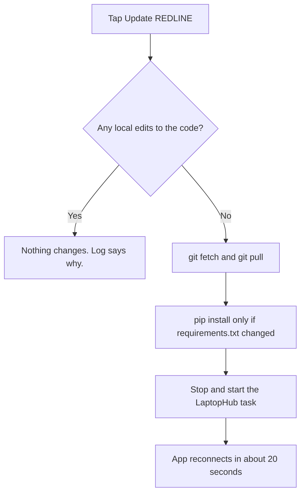

# 08 · Setup and updates

**What this page is for:** the setup wizard step by step, how to update REDLINE, how to make it start by itself, and how to back it up.

> ⚠️ **Careful:** The Windows setup steps have not been run on many real machines yet. If a step fails, run `python -m hub doctor` and read what it says.

## Start the wizard

Open PowerShell in the project folder, activate the venv, then:

```powershell
python -m hub setup
```

How it behaves:

- It asks **"Set up X?"** before every step. Press Enter to accept, or type `n` to skip.
- Secrets are typed **hidden**. Nothing shows while you type or paste. That is normal.
- Press Ctrl+C any time. It stops cleanly and lists what was done.
- You can re-run it as often as you like.
- At the end it prints a summary and runs the doctor.

Useful variations:

```powershell
python -m hub setup --only gmail,calendar
```

```powershell
python -m hub setup --check
```

`--check` changes nothing. It only tests what is already set up.

## The wizard steps

| # | Step | What it does | What you type |
|---|---|---|---|
| 1 | **Jarvis folder** | Finds or downloads your `jarvis-voice-assistant` folder. Calendar, email sending and Chat posting use its helper files. | A folder path. Enter accepts the suggestion. Then `y` to download. |
| 2 | **Gmail** | Saves a Gmail login so the Inbox and Watch can read mail. Tests reading and sending. | Your address, then the 16-letter **App password** (hidden). |
| 3 | **Asana** | Saves your Asana token and tests it. | The personal access token (hidden). |
| 4 | **Calendar** | Saves your calendar's secret iCal link and counts today's events. | The link (hidden). |
| 5 | **Google Chat** | Saves a webhook for each Space you want to post to. | A short space name, then the webhook URL (hidden). Enter to finish. |
| 6 | **AI** | Explains the brains, checks Claude Code, offers the Gemini key, saves your default. | Optional Gemini key (hidden), then a default: `auto`, `local`, `gemini`, `claude-login` or `duo`. |
| 7 | **Council** | Points the hub at your `multi-llm-lab` folder. Can download it and make its `.venv`. | A folder path, then `y` or `n`. |
| 8 | **Autopilot** | Optional. Turns on drafts that wait for your one tap, asks which git folders feed the standup and how drafts should sound. | `y` or `n`, folders (optional), a tone line. |
| 9 | **Phone push** | Makes a long random ntfy topic. | Nothing. It prints the topic. Subscribe to it in the ntfy app. |
| 10 | **Your name** | Sets what the app and Friday call you. | A name up to 20 characters. Enter keeps the current one. |
| 11 | **Cloudflare WARP** | Adds a "Connect Cloudflare" quick button if WARP is installed. | `y` or `n` |
| 12 | **Auto-start** | Makes the hub start when you log in. Offers to stop sleep while plugged in. | `y` or `n` twice |
| 13 | **Update button** | Adds the **Update REDLINE** button. | Nothing |

Step names you can use with `--only`: `jarvis`, `gmail`, `asana`, `calendar`, `chat`, `ai`, `gemini`, `council`, `autopilot`, `phone`, `name`, `warp`, `autostart`, `updater`.

> ✅ **Check:** The `gemini` name runs only the Gemini key part of the AI step.

> ⚠️ **Careful:** The phone-push topic acts like a password. It is printed on screen once. Do not share a screenshot of it. Topics on ntfy.sh are public, so a guessable name is unsafe.

## After setup

1. Run the health check:

```powershell
python -m hub doctor
```

Lines start with `[ok]`, `[--]` (optional, missing) or `[FIX]` (needs attention).

2. Restart the hub so it picks up the changes (see Auto-start below).
3. On the phone open **Setup** from Home. It shows a live checklist with fixes.

## Update REDLINE

There are two ways. The button is easiest.



### Way 1: the button

One-time setup on the laptop:

```powershell
git pull
```

```powershell
python -m hub install-updater
```

Restart the hub once so the button appears. After that:

1. On the phone open **Apps**, then **Laptop**, then **Quick buttons**.
2. Tap **Update REDLINE** and confirm.
3. Wait about 20 seconds. The app reconnects.
4. Check the build code (like `build abc1234`) in the Laptop or Setup screen.

> ✅ **Check:** The button runs as its own Windows task, `LaptopHubUpdate`, so stopping the hub cannot kill the updater.

If it does nothing, read the log:

```powershell
Get-Content $HOME\.laptop-hub\update.log -Tail 20
```

| Log says | Meaning |
|---|---|
| Local changes, nothing pulled | You edited code files. Run `git status`, then commit or discard, and tap again. |
| Not a fast-forward | The laptop's copy and GitHub differ. Ask for help before forcing anything. |
| Network or pip error | The running hub is left untouched. Try again. |

### Way 2: by hand

```powershell
cd D:\laptop-hub
```

```powershell
python -m hub update --restart
```

Use `python -m hub update` (no `--restart`) to pull without restarting.

If the hub is not running as the `LaptopHub` task, the updater starts `python -m hub serve` itself after pulling, and writes the outcome to `update.log` (the phone shows it in Settings).

### Checks and one-shot setup

```powershell
python -m hub doctor          # one line per thing: git, packages, hub, Tailscale, tasks, keys
python -m hub fix-deps        # installs requirements through python -m pip (never pip.exe)
python -m hub setup --all     # updater, watchdog and backup tasks, no questions
```

Your settings, notes and data live in `C:\Users\YOU\.laptop-hub` and are **not** touched by an update.

> ⚠️ **Careful:** The phone app (APK) only needs rebuilding if the `mobile/` folder changed or your Tailscale address changed. A normal update does not need a new APK.

## Auto-start

Step 11 of the wizard makes a Windows scheduled task called **LaptopHub**. It starts the hub when you log in and restarts it up to 3 times if it crashes.

```powershell
python -m hub setup --only autostart
```

| I want to | Command |
|---|---|
| Start it now | `Start-ScheduledTask -TaskName "LaptopHub"` |
| Stop it | `Stop-ScheduledTask -TaskName "LaptopHub"` |
| Remove auto-start | `Unregister-ScheduledTask -TaskName "LaptopHub" -Confirm:$false` |

```powershell
Start-ScheduledTask -TaskName "LaptopHub"
```

```powershell
Stop-ScheduledTask -TaskName "LaptopHub"
```

> ✅ **Check:** Tailscale's `serve --bg` setting survives restarts by itself.

> ⚠️ **Careful:** Auto-start runs **when you log in**. After a restart, sign in at the laptop once.

Also keep the laptop awake while plugged in:

```powershell
powercfg /change standby-timeout-ac 0
```

## Backups

In the app: **Settings**, then **Backups**, then make a backup. It writes one zip file on the laptop.

| Item | Detail |
|---|---|
| Where | `C:\Users\YOU\.laptop-hub\data\backups\` |
| Name | `hub-backup-YYYYMMDD-HHMMSS.zip` |
| Kept | The newest 5 |
| Contains | App data, your notes, the activity log |
| Does **not** contain | `hub.json`, your token hash, the session secret |
| Size limit | 2 GB |

Back up two more things yourself:

- Copy `hub.json` to a safe private place now and then. It holds your settings and shared-folder list.
- Keep your login token in a password manager. If you lose it, make a new one (page 10).

Secrets in the Windows keyring and the Asana token file are not in the zip either. You can recreate them with the wizard.

## Weekly backup and watchdog

Two optional scheduled tasks, set up with `python -m hub setup --only backup,watchdog`.

| Task | When | What it does |
|---|---|---|
| `LaptopHubBackup` | Sundays 11:00 | Runs `python -m hub backup`: one zip in `Documents\REDLINE-backups`, newest 8 kept, a push "Backup done: 14 MB" |
| `LaptopHubWatchdog` | Every 10 minutes | Starts the hub if it died, starts Tailscale if it stopped, restores the Tailscale link. Pushes to your phone only when it fixed something or needs you |

The backup holds your settings (not the login token or session secret), data, `HubNotes` and `HubInbox`. Put a different folder in `backup_dir` in `hub.json` if you want it elsewhere (a synced folder is a good idea).
To restore: `python -m hub backup --restore ZIP`, type `RESTORE`, then restart the hub. A safety copy of the current state is made first.
The watchdog writes one line per run to `C:\Users\YOU\.laptop-hub\watchdog.log`. `python -m hub doctor` shows whether both tasks exist.

## Quick buttons

Quick buttons are saved in `hub.json`. They can only be added on the laptop, never from the phone. Example:

```powershell
python -m hub add-script backup --label "Back up notes" -- robocopy C:\Users\YOU\HubNotes D:\backup\notes /MIR
```

Names use lowercase letters, digits, `-` and `_`. Restart the hub after adding one.

## Change the phone app's address

The address is built into the APK. If your Tailscale address changes, run the GitHub workflow **Build Android APK** again with the new address, uninstall the old app, and install the new one.
