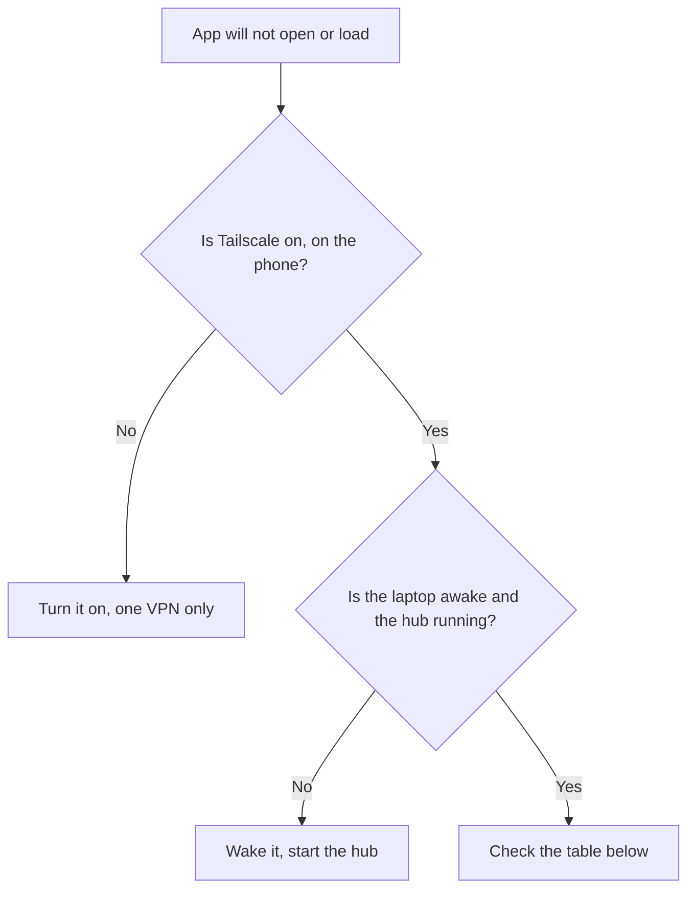

# 09 · Troubleshooting

**What this page is for:** find your symptom, see the likely cause, and apply the fix.

## First, always

Run the health check on the laptop. It lists what is missing.

```powershell
python -m hub doctor
```

Lines starting with `[FIX]` need attention. `[--]` means optional and missing.

## Which problem is it?



## Connection and login

| Symptom | Cause | Fix |
|---|---|---|
| "Could not be resolved" or `ERR_NAME_NOT_RESOLVED` | Tailscale is off on the phone, so the `...ts.net` name is unknown. | Open the Tailscale app, switch it on, retry. |
| "Can't reach your laptop" | The hub is not running, or the laptop is asleep or offline. | Wake the laptop. Run `python -m hub serve` or `Start-ScheduledTask -TaskName "LaptopHub"`. |
| Tailscale will not connect, another VPN is on | Android allows only **one VPN at a time**. Cloudflare WARP or a company VPN switches Tailscale off. | Use one VPN at once. Turn WARP off on the phone while you use REDLINE. On the laptop, check WARP and Tailscale are not fighting. 🟡 The WARP button is not tested on real devices yet. |
| "That token didn't match" | Typo, an old token, or a new token the hub has not loaded. | Paste the token again. If you made a new one, restart the hub (next row). |
| New token still rejected | The hub reads the token only when it starts. | Restart the hub after `python -m hub token`. |
| "Too many tries. Wait a minute" | Five wrong logins locks login for one minute. | Wait 60 seconds. |
| "Your session ended. Please log in again." | You logged out everywhere, or the token changed. | Log in again. |
| "This address is not allowed" | You used an IP or a different name. | Open the `https://...ts.net` address. |
| Microphone says it needs HTTPS | You opened an `http://` or IP address. | Use the `https://...ts.net` address. |
| Terminal opens, then closes | The origin check failed. | Add the address to `allowed_origins` in `hub.json`, restart. |
| Laptop asleep | Sleeping laptops cannot answer. | Wake it by hand. Set no sleep while plugged in (page 06). |

## AI problems

| Symptom | Cause | Fix |
|---|---|---|
| Gemini: "This key's free tier has no quota for the available models" | Your key has a free limit of 0. | New key from a fresh AI Studio project, or enable billing, or use Claude login or Local. A Google AI Pro subscription does **not** give API quota. |
| Gemini: "no quota" for a while, then fine | Daily limits reset. | Wait, or pick another brain. |
| Gemini: "doesn't know that model" or model not found | Wrong or retired name in `gemini_model`. | The hub tries other stable models by itself. If it keeps failing, fix `gemini_model` in `hub.json`. |
| "The Gemini API key was rejected" | Wrong or deleted key. | `python -m hub setup --only gemini` |
| "Your Claude usage limit is reached" | Subscription window used up. | Wait for reset or pick Gemini or Local. |
| Claude login: "not logged in" | `claude` was never signed in. | Open a terminal, run `claude`, sign in. |
| Duo shows "Claude supervisor paused" | Claude hit a limit or failed. Gemini works alone for a while. | Nothing. It retries after the pause. |
| Explain or Quiz: "Ollama isn't running" | The Ollama app is closed. | Open Ollama. Then `ollama pull qwen3:4b`. |
| Ask my files says "keywords only" | The meaning-search model is missing. | `ollama pull nomic-embed-text`, then rescan. |
| Notes have no tags | The local model adds them a few seconds later. | Wait, then run doctor. |
| Voice note: "needs faster-whisper" | Voice packages not installed. | `pip install -r requirements-voice.txt` |

## Phone and Android

| Symptom | Cause | Fix |
|---|---|---|
| Notification access switch is greyed out, or says **Restricted setting** | Android 13 and newer block APK apps from this. | Settings, Apps, REDLINE, three-dot menu, **Allow restricted settings**. Then turn on Notification access again. |
| No payment or Chat alerts | Notification access is off, or restricted, or monitoring is off. | Fix the row above, then turn monitoring on in Watch or Spending. 🟡 Not tested on real devices yet. |
| Capture stops in the background | Phone saves battery by stopping the app. | Settings, Apps, REDLINE, Battery, **Unrestricted**. |
| "App not installed" | An older build is installed with a different signing key. | Uninstall the old app, install the new one. Your data is on the laptop. |
| App opens blank or shows an error | Tailscale off, hub off, or the wrong address was built in. | Check both. The address must match `tailscale serve status`. |
| No push when the app is closed | The ntfy app is not subscribed to your topic, or quiet hours. | Subscribe to the same topic. Check quiet hours. |

## Laptop features

| Symptom | Cause | Fix |
|---|---|---|
| Terminal will not open on Windows | `pywinpty` missing. Windows terminal path not tested widely. | `pip install pywinpty` |
| Remote screen says something is missing | Screen packages not installed. | `pip install -r requirements-screen.txt`, restart hub |
| Screen shows but taps do nothing | Control is off until armed. | Tap **Enable control** |
| Files: "That folder is read-only" | The folder is not in `writable_roots`. | Add its name to `writable_roots` in `hub.json`, restart |
| Inbox: Gmail not set up | App password missing. | `python -m hub setup --only gmail` |
| Gmail login rejected at work | Admin turned off app passwords or IMAP. | Ask the admin, or use a personal Gmail. |
| Calendar shows 503 | No Jarvis folder or calendar link. | `python -m hub setup --only jarvis` then `--only calendar` |
| Update button did nothing | Edited code files, or no network. | Read `update.log` (page 08). Run `git status`. |
| Update button is missing | The updater was never installed, or the hub was not restarted. | `python -m hub install-updater`, restart hub |
| Phone app dark while you are away | Hub or Tailscale died. | Install the watchdog: `python -m hub setup --only watchdog`. Read `watchdog.log`. |
| Push says "Tailscale is logged out" | Tailscale needs you to sign in (it needs a browser). | Open the laptop, click the Tailscale icon, sign in. |
| Need an old file back | Backup zips are in `Documents\REDLINE-backups`. | `python -m hub backup --restore ZIP` (page 08) |
| Council says it is not set up | `council_dir` is empty. | `python -m hub setup --only council`, restart hub |

> ✅ **Check:** After any fix to `hub.json` or a new package, restart the hub.

> ⚠️ **Careful:** If nothing here helps, copy the exact error text (never your token or keys) and ask Claude, with the doctor output.
