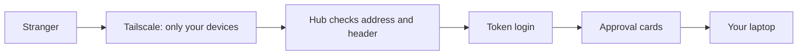
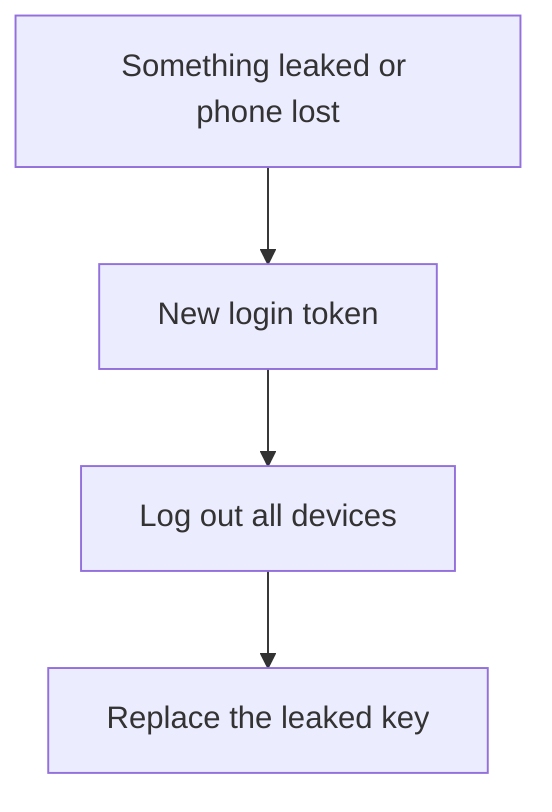

# 10 · Security and privacy

**What this page is for:** what REDLINE can do on your laptop, what protects it, what you must never share, how to change your keys, and what a stranger could do.

## The honest summary

A logged-in phone can do almost anything you can do at the laptop. That is on purpose. So the phone and the token must be protected like a house key.

> ⚠️ **Careful:** Lock your phone. Anyone with your unlocked phone and the app logged in has the keys to your laptop.

## What the app can do

| Power | Limit |
|---|---|
| Run commands in a Terminal | None. Full access as you. |
| Let the assistant run commands and write files | You approve each action, unless you switch approvals off for a session. |
| Read your shared folders | Only the folders you chose |
| Change files | Only in `writable_roots` (default `notes` and `inbox`) |
| Watch the screen | Needs login |
| Click and type on the screen | Needs arming, 1 to 15 minutes |
| Lock, sleep, restart, shut down | Sleep, restart and shutdown ask first |
| Read Gmail | Read only. Drafts replies. Never sends from the Inbox. |
| Send email or post to Chat | Only from Work, after you review and tap |

## What protects it



| Layer | What it does |
|---|---|
| **Tailscale only** | The hub listens on the laptop itself. Nothing is open to the internet. |
| **Login token** | One long random password. Only its **hash** is stored. |
| **Lockout** | Five wrong tries lock login for one minute. |
| **Signed cookie** | Keeps you logged in for 14 days. It cannot be read by page scripts and is not sent from other sites. |
| **Address check** | The hub answers only to localhost and `ts.net` names. |
| **Header check** | Every change request must come from the app. |
| **Approval cards** | Show the whole action. The AI cannot skip them. |
| **Safety is code, not AI** | Approvals, path limits and protected files are enforced by the program. |
| **Data, not orders** | Text in files, mail and command output is treated as data. It cannot tell the assistant what to do. |
| **Protected files** | The assistant cannot rewrite the hub's own settings or the activity log. |
| **Remote control timer** | Control switches itself off. |
| **Trash** | Deleted files can be restored. |
| **Activity log** | `audit.log` records logins, terminal open and close, quick buttons, assistant requests and approvals. |

> ⚠️ **Careful:** The activity log does **not** record what you type in the Terminal. And one known gap: after you approve a command, it can still touch the hub's own settings. Approve with care.

## Full Control mode

Off by default, and the owner's explicit choice. When `full_control` is true in `hub.json` (or switched on in
Settings), the assistant and Friday run every tool without an approval prompt: commands, file writes, scripts,
sends. Safety that stays in code: the login, the phone-only Tailscale path, the protected `~/.laptop-hub` folder
(token and audit log cannot be written by the assistant's file tool), the refusal to read credential folders,
command timeouts (60 s default, 600 s max) and output caps. Safety that goes away: the approval tap.

Be honest with yourself about it: a command run by the assistant can still change anything your user account can,
including things the file tool refuses, and it cannot be undone. Anyone with your unlocked phone and the open app
controls the laptop. A prompt-injected web page or file can ask the AI for something harmful and nothing will stop
it. Use it on your own laptop, with a phone lock, and turn it off when you do not need it.

Turn it on: Settings > Account and security > Full Control, then type `I UNDERSTAND` (the hub rejects the change
without it). Turn it off: one tap on the red chip in the header, or the same Settings row, or set
`"full_control": false` in `hub.json`. The audit log records every automatic action with `"full_control": true`.

## What never to share

| Never share | Why |
|---|---|
| Your login token | It is the key to the hub. |
| Gemini, Anthropic, Asana, ntfy, Gmail app password | Each opens that service as you. |
| Your calendar's secret iCal link | Anyone with it can read your calendar. |
| Chat webhook URLs | Anyone can post into that Space. |
| The ntfy topic | Anyone who knows it can read your alerts and send fake ones. |
| `hub.json` | It holds your settings and session secret. |
| Screenshots of the setup wizard, Settings or Terminal | They may show the topic or other private data. |

> ✅ **Check:** Your Tailscale address (`shikharonestack.tail3ffc35.ts.net`) is not secret on its own. Without your Tailscale account and the token, it is useless.

## Rotate things



| Situation | What to do |
|---|---|
| **Phone lost or stolen** | Run `python -m hub token`, restart the hub, and remove the phone from your Tailscale account. |
| **Token leaked** | Same: `python -m hub token`, then restart the hub. |
| **Log everyone out** | In the app, **Settings**, **Log out of all devices**. |
| **Gemini key leaked** | Delete it at aistudio.google.com/apikey, make a new one, run the Gemini setup. |
| **Gmail app password leaked** | Revoke it at myaccount.google.com/apppasswords, make a new one, run the Gmail setup. |
| **Asana token leaked** | Delete it in Asana's developer console, make a new one, run the Asana setup. |
| **ntfy topic leaked** | Run the phone setup to get a new topic, subscribe to it, drop the old one. |
| **Calendar link leaked** | Reset the secret address in Google Calendar, run the calendar setup. |
| **Chat webhook leaked** | Delete the webhook in the Space, make a new one, run the chat setup. |

Commands:

```powershell
python -m hub token
```

```powershell
python -m hub setup --only gemini
```

```powershell
python -m hub setup --only phone
```

```powershell
python -m hub setup --only gmail
```

```powershell
python -m hub setup --only asana
```

> ⚠️ **Careful:** `python -m hub token` prints the new token **once**. Save it in a password manager. Then restart the hub, or the old token keeps working.

## What a stranger could do if they had...

| If they had | They could | They could not |
|---|---|---|
| Your Tailscale address only | See the login page, if they are on your tailnet | Log in, or even reach it from outside |
| The address and a wrong token | Try five times a minute | Get in by guessing |
| Your login token, but not your tailnet | Nothing, because they cannot reach the hub | |
| Your token **and** a device on your tailnet | Do almost anything you can do on the laptop | Skip approval cards in the assistant |
| Your unlocked, logged-in phone | The same, including the Terminal | |
| Your ntfy topic | Read your push alerts, send fake alerts | Reach the hub |
| Your Gemini key | Spend your free quota | Reach the laptop |
| Your `hub.json` | See your folder list and settings | Log in. It holds a token hash, not the token. |
| A backup zip | Read your notes and data | Log in. It has no token hash or secrets. |

## Hiding private details from cloud AI

Before a message, a tool result or file text goes to Gemini or Claude, REDLINE replaces emails, phone numbers, card numbers, Aadhaar and PAN numbers, IBANs, API keys, passwords written after a label like `password:`, and any words you list (your employer, a project name) with tags such as `[EMAIL_1]`. The AI works with the tags, and the hub puts your real values back into the answer and into tool calls on the laptop. Turn it on or off, choose what is hidden and try it on a sample in **Settings > Privacy redaction**. The local model is never filtered, because nothing leaves the laptop.

What it can and cannot do: it recognises **shapes**, not meaning. It will not hide a person's name or an address you did not list, a secret with no label, details the AI can work out from the rest of your text, or anything inside a screenshot (Screen vision sends the picture as it is), and Council runs talk to their models directly. It is a seat belt, not a vault. For truly private work pick **Local**. The activity log records only how many items of each kind were hidden, never the values.

**Usage and caps.** Settings > Usage today (and a small row on Home) counts requests per AI per day. Set daily caps with **Edit caps**; when one is reached the assistant answers with the local model for that message, says so, and never silently switches to another paid AI. Say "use gemini anyway" to go over the cap once. The Claude 5-hour figure is your own estimate, not something Claude reports.

## Privacy summary

- **Local model and Whisper** keep your words on the laptop.
- **Gemini and Claude** receive what you send them. Pick **Local** for private things.
- **Phone push** uses the public ntfy.sh server. Keep secrets out of reminder and note titles.
- **Payment, Gmail and Chat capture** reads only listed apps' notifications, and sends them only to your own hub. 🟡 Not tested on real devices yet.
- **SMS** permission, if you grant it, is receive-only. The app cannot read your inbox.

## Three safety levels (read this once)
Every action the assistant takes has a level. **Level 1** only looks (list a folder, read a file): it just runs.
**Level 2** changes something (save a file, run a normal command): you get the Approve card, or it runs by itself
if Full Control is on. On a Level 2 card you can tap "Allow this for 1 hour" so the same kind of thing does not
ask again; Settings > Account and security > Active permissions lists what you allowed, each with a Revoke button
(they vanish by themselves, and when Full Control changes). **Level 3 is critical**: shutting down or restarting,
formatting, deleting folders or many files, killing programs, changing the registry or the hub's own settings,
force-pushing code, switching off the firewall, Tailscale or Defender, installing software, or touching password
files. Level 3 never runs on its own, not even in Full Control, and a spoken "yes" does not count. The card turns
red and shows the exact command; you must type CONFIRM, then watch a 10 second countdown where Cancel stops it.
