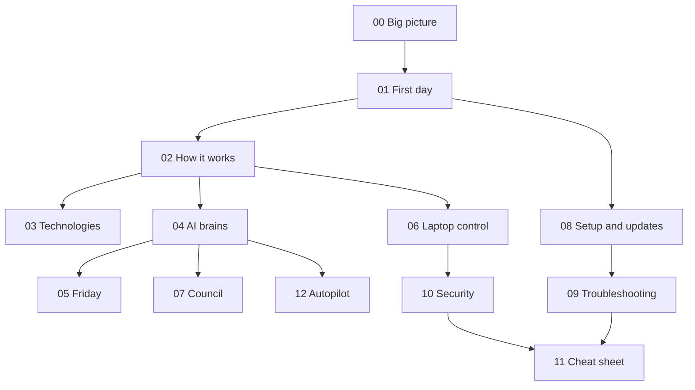

# REDLINE beginner guide

**What this page is for:** the front door. It says what these pages are and the order to read them.

REDLINE is an Android app that controls your Windows laptop. This guide explains it in plain words, for someone who did not write the code. You can hand these pages to a new person and they will understand.

## Read in this order

1. [00 · The big picture](00-big-picture.md): what REDLINE is and how it fits your work.
2. [01 · Your first day](01-first-day.md): what to install, first login, a tour of the screens.
3. [02 · How it works](02-how-it-works.md): the five pieces, where data lives, what is private.
4. [03 · Technologies explained](03-technologies-explained.md): a glossary of every tool and library.
5. [04 · AI brains](04-ai-brains.md): local, Claude, Gemini and the duo.
6. [05 · Friday, your daily assistant](05-friday-assistant.md): briefs, plans and alerts.
7. [06 · Controlling your laptop](06-laptop-control.md): launcher, screen, terminal, files, approvals.
8. [07 · The Council in the app](07-council-in-the-app.md): running the multi-model team.
9. [08 · Setup and updates](08-setup-and-updates.md): the wizard, updating, auto-start, backups.
10. [09 · Troubleshooting](09-troubleshooting.md): symptom, cause, fix.
11. [10 · Security and privacy](10-security-and-privacy.md): what protects you, what to never share.
12. [11 · Cheat sheet](11-cheat-sheet.md): one printable page.
13. [12 · Autopilot](12-autopilot.md): drafts that wait for your one tap.
14. [13 · Today](13-today.md): your whole day on one page.
15. [14 · Skills](14-skills.md): add community skills for Jarvis and Friday.
15. [14 · Research](14-research.md): ask once, get a report with numbered sources.

Also: [How to import this guide into Notion](IMPORT-INTO-NOTION.md).

## How the pages connect

## Quick start by goal

| I want to... | Read |
|---|---|
| Understand it in five minutes | 00 |
| Get it running | 01, then 08 |
| Fix a problem now | 09 |
| Know what is safe | 10, 12 |
| Have drafts ready for one-tap approval | 12 |
| Hand it to someone else | 00, 01, 11 |

## How to read the marks

| Mark | Meaning |
|---|---|
| ✅ Check | A good thing to confirm |
| ⚠️ Careful | A risk or a common mistake |
| 🟡 Not tested on real devices yet | Built and tested only with fake data. Expect small fixes. |
| 🟢 Worked on the first real run | Seen working on the owner's laptop and phone |

> ⚠️ **Careful:** No page in this guide contains a real token, key or ntfy topic. Never add one.

## About this guide

It matches the project as of its `HANDOFF.md` (last updated 2026-11-04, with later notes through 2026-11-12). If the code changes, update the page that mentions it.
