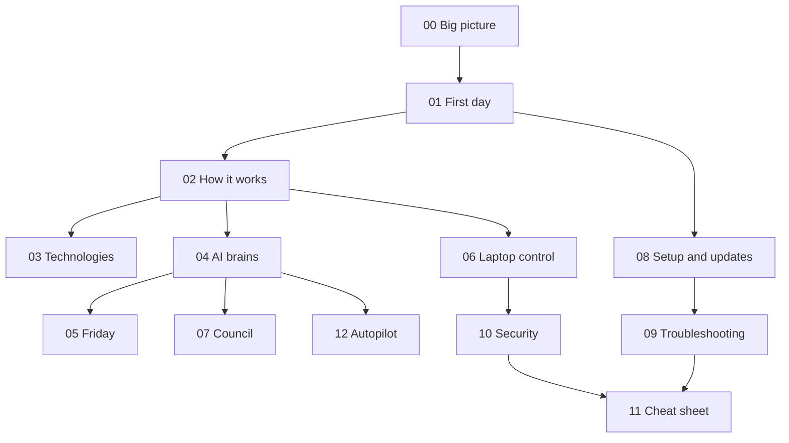

# REDLINE beginner guide

**What this page is for:** the front door. It says what these pages are and the order to read them.

REDLINE is an Android app that controls your Windows laptop. This guide explains it in plain words, for someone who did not write the code. You can hand these pages to a new person and they will understand.

## Read in this order

1. [00 · The big picture](00-big-picture.md): what REDLINE is and how it fits your work.
2. [01 · Your first day](01-first-day.md): what to install, first login, a tour of the screens.
3. [02 · How it works](02-how-it-works.md): the five pieces, where data lives, what is private.
4. [03 · Technologies explained](03-technologies-explained.md): a glossary of every tool and library.
5. [04 · AI brains](04-ai-brains.md): local, Claude, Gemini and the duo.
6. [05 · Friday, your daily assistant](05-friday-assistant.md): briefs, plans and alerts.
7. [06 · Controlling your laptop](06-laptop-control.md): launcher, screen, terminal, files, approvals.
8. [07 · The Council in the app](07-council-in-the-app.md): running the multi-model team.
9. [08 · Setup and updates](08-setup-and-updates.md): the wizard, updating, auto-start, backups.
10. [09 · Troubleshooting](09-troubleshooting.md): symptom, cause, fix.
11. [10 · Security and privacy](10-security-and-privacy.md): what protects you, what to never share.
12. [11 · Cheat sheet](11-cheat-sheet.md): one printable page.
13. [12 · Autopilot](12-autopilot.md): drafts that wait for your one tap.
14. [13 · Today](13-today.md): your whole day on one page.
15. [14 · Skills](14-skills.md): add community skills for Jarvis and Friday.
16. [15 · Research](15-research.md): ask once, get a report with numbered sources.
17. [16 · Memory](16-memory.md): Jarvis and Friday remember RCAs, decisions and follow-ups.
18. [17 · Build flow](17-build-flow.md): tell Jarvis what to build; spec, plan, then step by step.
19. [18 · Claude sessions](18-claude-sessions.md): watch Claude Code on your laptop from your phone.
20. [19 · Opportunities](19-opportunities.md): finds, sources and your profile.
20. [20 · Applications](20-applications.md): drafted applications wait for your tap; nothing is sent by itself.
20. [21 · Posts](21-posts.md): one draft to many places (dev.to, Hashnode, your blog, LinkedIn, X...), your own destinations list.
20. [22 · Urgent alerts](22-urgent-alerts.md): Friday tells you first, with a draft you send yourself.
20. [23 · Your lists](23-your-lists.md): assistants, notification choices, your own safety and privacy rules, memory kinds and tags.
20. [24 · Provider lists](24-provider-lists.md): search, vision, AI endpoints, skill sources, coding agents.
20. [25 · Local models](25-local-models.md): DeepSeek and other Ollama models, install, deep thinking, speed test.
20. [26 · Dictation](26-dictation.md): hold a key on the laptop, speak, and it types into the window in front.
20. [26 · MCP servers](27-mcp-servers.md): add tool servers (MCP) to a list; every tool call asks first.
20. [28 · Work lanes](28-work-lanes.md): give routine work to the free Council first, escalate only when needed, private work stays local.
21. [29 · Agent controls](29-agent-controls.md): the Panic button, trust rules and the "What did the agent do?" timeline.
22. [30 · Presence](30-presence.md): alerts follow where you are: laptop, away, in a meeting.
20. [31 · A voice that sounds like Jarvis and Friday](31-voice.md): natural laptop voices, a different voice per assistant, interrupt by talking.
23. [32 · Meetings](32-meetings.md): record a meeting (with consent), get notes and action items for your tasks.
24. [33 · Computer control](33-computer-control.md): Jarvis clicks and types in apps you approve, step by step (read the warning first).
24. [33 · Playbooks](34-playbooks.md): "when this happens, do that" rules, with the same approvals as everything else.
25. [35 · Job preferences and daily batches](35-job-preferences-and-batches.md): what work you want, and a batch of ready applications at the times you choose, sent with one tap.
25. [37 · Job and gig sources](37-job-sources.md): company job boards, remote boards, freelance email alerts, a company watch list; nothing is submitted without your tap.
26. [38 · Google Chat with a personal account](38-google-chat-personal.md): read Chat from notifications and emails, a draft per space, copy and open Chat to reply; it never sends.
25. [36 · Tailor and answers](36-tailor-and-answers.md): a resume and cover note for each job from your own facts, an honesty check, and your saved answers to form questions.
27. [40 · Networking drafts](40-networking-drafts.md): short referral, recruiter, thank-you and follow-up drafts from your own facts, a contacts list with nudges; you send everything yourself.
28. [41 · Interview coach](41-interview-coach.md): likely questions, practice with feedback, STAR stories, a 60 and 90 second intro, a brief and a pay cheat sheet; nothing is sent.
29. [42 · ATS and packets](42-ats-and-packets.md): how a posting scores against your resume, how an ATS reads your resume file, master resumes per role, a tailoring queue and a one-page application packet; nothing is sent.
21. [99 · Troubleshooting new features](99-troubleshooting-new-features.md): plain fixes for first-run problems.

Also: [How to import this guide into Notion](IMPORT-INTO-NOTION.md).

## How the pages connect

## Quick start by goal

| I want to... | Read |
|---|---|
| Understand it in five minutes | 00 |
| Get it running | 01, then 08 |
| Fix a problem now | 09 |
| Know what is safe | 10, 12 |
| Have drafts ready for one-tap approval | 12 |
| Hand it to someone else | 00, 01, 11 |

## How to read the marks

| Mark | Meaning |
|---|---|
| ✅ Check | A good thing to confirm |
| ⚠️ Careful | A risk or a common mistake |
| 🟡 Not tested on real devices yet | Built and tested only with fake data. Expect small fixes. |
| 🟢 Worked on the first real run | Seen working on the owner's laptop and phone |

> ⚠️ **Careful:** No page in this guide contains a real token, key or ntfy topic. Never add one.

## About this guide

It matches the project as of its `HANDOFF.md` (last updated 2026-11-04, with later notes through 2026-11-12). If the code changes, update the page that mentions it.
27. [39 · Job tracker](39-job-tracker.md): every application with its status, day 5 and 10 follow-up reminders with a draft nudge you copy yourself, and which sources get replies.
28. [45 · Replies, insights and personal outreach](45-replies-insights-outreach.md): job mail sorted on your laptop with confirm-first suggestions, what is working plus one experiment a week, and batched personal emails sent with one tap.
29. [48 · Company brief](48-company-brief.md): a one-page brief from public sources only, red flags, and who you know at the company.
30. [49 · Offers and negotiation](49-offers-and-negotiation.md): record and compare offers with an India in-hand estimate, a counter-offer draft, a clause checklist and a pay check.
31. [50 · Freelance proposals](50-freelance-proposals.md): proposal drafts from your own facts with three openings, and which opening wins more. You submit by hand.
32. [51 · Share to REDLINE](51-share-to-redline.md): share a job from LinkedIn, Naukri or any phone app to REDLINE; only the shared text is read, you get a go / no-go and the ATS match, and one-tap Tailor + packet or Add to apply queue.
33. [52 · Form filling on more job sites](52-form-adapters.md): the application filler now understands SuccessFactors, Taleo, Oracle Recruiting, iCIMS and Ashby. You still sign in, answer voluntary questions and press Next and Submit.
